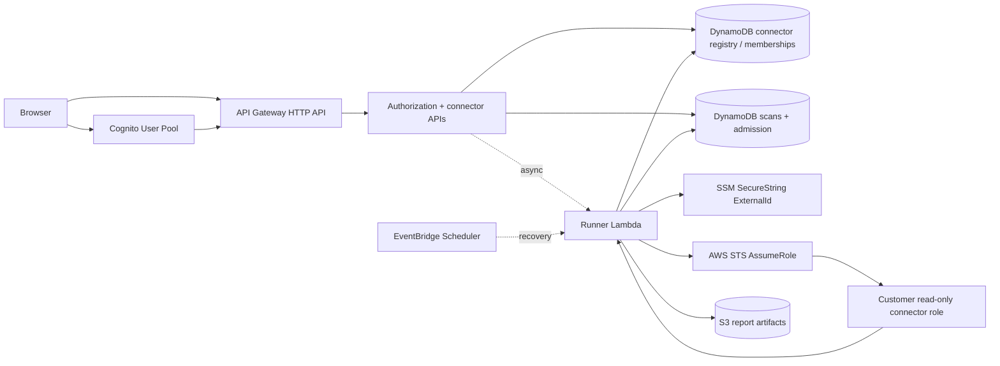

# Architecture

AWS Security Coach is a serverless AWS posture-assessment application built around a hosted control plane and customer-controlled read-only cross-account connectors.

The design goal is bounded evidence collection, not continuous monitoring or a generalized CSPM platform.

## System overview



## Trust boundaries

### Browser

The browser is untrusted for authorization decisions.

It may present connector IDs, scan IDs, and application state, but server-side handlers independently verify role, ownership, membership, and resource access.

Access tokens are obtained through Cognito authorization-code flow with PKCE and are kept in memory by the application.

### Application control plane

The hosted AWS account contains the API, Lambda functions, DynamoDB tables, S3 report storage, Cognito resources, EventBridge recovery path, and protected connector metadata.

Connector ExternalIds are stored in SSM Parameter Store and are not returned to general browser views after setup.

### Customer AWS account

A customer deploys the versioned CloudFormation connector role in their own AWS account.

The role is intentionally read-only and bounded by:

- role path `/aws-security-coach/`;
- tag `AWSSecurityCoachConnector=true`;
- exact trusted runner role;
- connector-specific ExternalId; and
- the permissions required by the current ruleset.

The application assumes that role through STS and receives short-lived credentials. Customer AWS passwords, console credentials, and long-lived access keys are not part of the design.

## Authorization model

Application authorization is server-side and combines validated identity with application-owned state.

Operators can manage connectors and run authorized assessments.

Customers can access only connectors associated with their environment-scoped pseudonymous requester reference through connector membership state.

Target discovery, scan creation, scan reads, report reads, and connector lifecycle operations are authorization-checked independently.

## Scan lifecycle

A scan request is admitted through DynamoDB conditional state and asynchronously invokes the runner.

```text
QUEUED -> RUNNING -> COMPLETE
                  -> FAILED
```

Admission controls include:

- idempotency;
- active-scan locking;
- cooldowns;
- bounded leases;
- API throttling; and
- reserved Lambda concurrency.

EventBridge Scheduler provides a separate recovery path for queued work and bounded handling of stale running state.

## Assessment scope

The active ruleset contains nine bounded controls covering root/IAM hygiene, access-key age/use, password policy, multi-Region CloudTrail trail presence, S3 account-level Block Public Access, and internet-exposed SSH/RDP security groups.

Account-global controls are evaluated as account-global.

For connector template `1.1.0`, the SSH/RDP security-group control evaluates all Regions enabled for the connected account and fails closed when regional coverage is incomplete.

The CloudTrail rule intentionally proves only that at least one multi-Region trail is present. It does not claim active logging, successful delivery, event-selector coverage, or retention.

## Reporting

The application normalizes one security result model and renders it in four contexts:

- managed Management;
- managed Engineering;
- self-service Management; and
- self-service Engineering.

PDFs are generated in the browser from normalized report data. The report layer may change presentation and workflow guidance, but it does not change the underlying security finding truth.

## Delivery architecture

Development and production are isolated by AWS resources, GitHub Environments, deployment roles, variables, and hosted configuration.

GitHub Actions uses AWS OIDC instead of stored AWS access keys.

The intended promotion model is:

1. validate source;
2. deploy and verify development;
3. complete runtime acceptance;
4. promote accepted source to `main`;
5. deploy and verify production.

See `PUBLIC_CONFIGURATION.md` for sanitized deployment placeholders.
