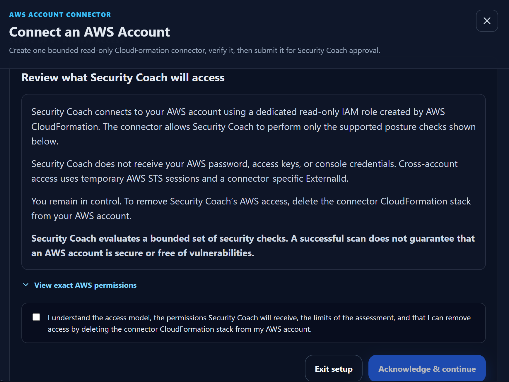
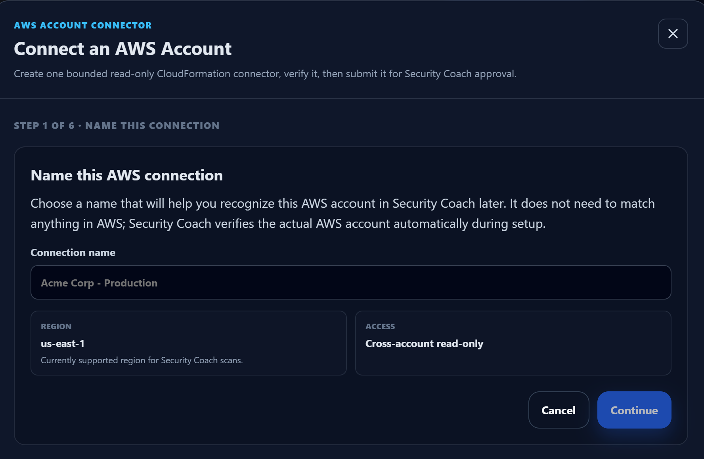
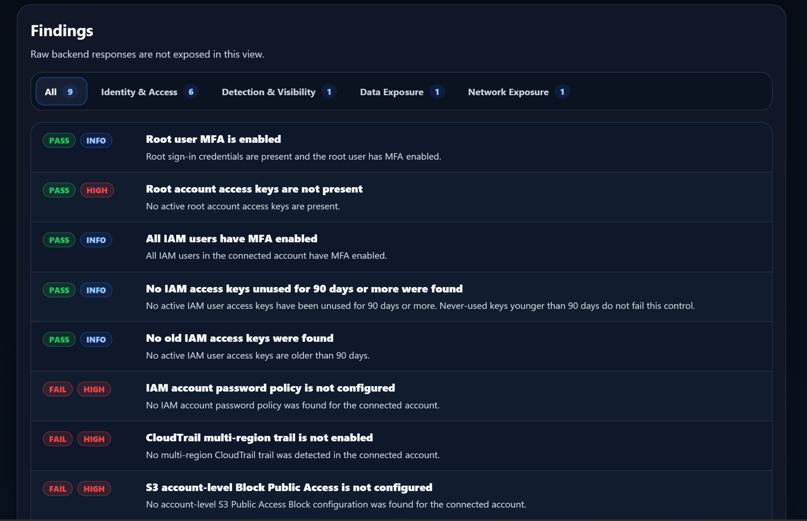
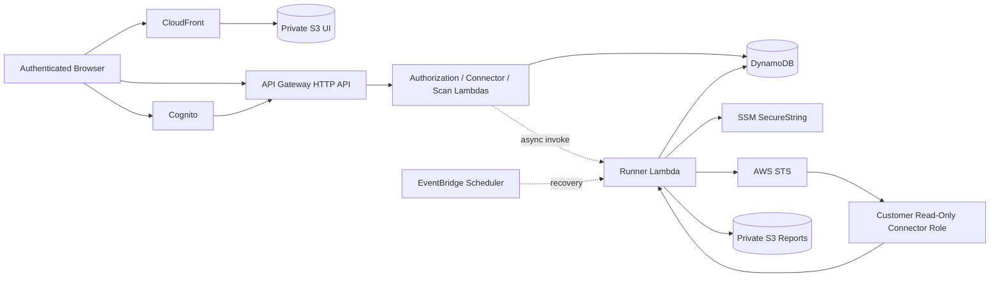

# AWS Security Coach

**A serverless AWS security posture assessment platform built to demonstrate secure cloud architecture, cross-account IAM, CI/CD, Infrastructure as Code, authenticated multi-user workflows, evidence-backed security checks, and production-oriented engineering discipline.**

[](https://github.com/AndrewDeFever/AWS-Security-Coach-Showcase/actions/workflows/validate-source.yml)


> **Portfolio note:** this repository is a sanitized public derivative of a privately developed and operated project. The engineering journey is reconstructed from implementation records, runtime evidence, production incidents, and acceptance testing. Private customer/account data, live deployment identifiers, and the original private Git history are intentionally excluded.

**Start here:** [Engineering Journey](ENGINEERING_JOURNEY.md) · [Architecture](ARCHITECTURE.md) · [Security](SECURITY.md) · [Public Configuration](PUBLIC_CONFIGURATION.md)

---

## Table of Contents

- [Why this project exists](#why-this-project-exists)
- [What this demonstrates](#what-this-demonstrates)
- [Product walkthrough](#product-walkthrough)
- [Architecture](#architecture)
- [Security model](#security-model)
- [Assessment scope](#assessment-scope)
- [Engineering highlights](#engineering-highlights)
- [CI/CD and deployment](#cicd-and-deployment)
- [Repository structure](#repository-structure)
- [Getting started](#getting-started)
- [Validation](#validation)
- [Reporting](#reporting)
- [What this is not](#what-this-is-not)
- [Engineering journey](#engineering-journey)

## Why this project exists

Cloud security projects often fail in one of two directions: they become so broad that their claims are difficult to verify, or they stay so small that they never demonstrate a complete operating model.

AWS Security Coach was built around a different goal:

> **Build a narrow security product deeply enough to prove the full engineering loop.**

That means the project is intentionally more than scanner logic. It includes:

- a hosted React application;
- Cognito authentication with authorization-code + PKCE;
- server-side role and membership enforcement;
- read-only cross-account AWS connectors;
- deterministic scan admission and execution;
- development/production isolation;
- AWS SAM / CloudFormation infrastructure;
- GitHub Actions deployments through AWS OIDC;
- bounded negative-path testing;
- management and engineering reporting;
- production troubleshooting and runtime acceptance;
- and explicit limits on what the assessment can claim.

The scanner remains deliberately bounded at nine controls. The portfolio value is the **architecture, trust boundaries, delivery model, operational debugging, and evidence discipline** around those checks.

## What this demonstrates

| Area | Implementation |
| --- | --- |
| **Frontend** | React, TypeScript, Vite, CloudFront, private S3 |
| **Authentication** | Amazon Cognito authorization-code flow with PKCE |
| **API authorization** | API Gateway JWT validation plus backend role/membership enforcement |
| **Cross-account AWS** | STS `AssumeRole`, connector-specific ExternalId, customer-deployed read-only IAM role |
| **Backend** | Python Lambda, API Gateway, DynamoDB, S3, EventBridge Scheduler |
| **Infrastructure as Code** | AWS SAM and CloudFormation |
| **CI/CD** | GitHub Actions with AWS OIDC; no stored AWS deployment access keys |
| **Environment isolation** | Separate development and production application resources and deployment identities |
| **Scan reliability** | Idempotency, admission locks, cooldowns, bounded leases, throttling, concurrency controls |
| **Security posture** | Nine evidence-backed AWS checks with explicit scope semantics |
| **Reporting** | Management + Engineering experiences and deterministic browser-generated PDFs |
| **Testing** | Unit, infrastructure, source-sanitization, positive-path, and negative-path verification |
| **Operational discipline** | Dev-first promotion, hosted acceptance, cleanup evidence, production incident analysis |

## Product walkthrough

The public showcase includes a small, sanitized set of product screenshots and sample deliverables. These assets are presentation-safe derivatives and intentionally exclude live customer/account identifiers, connector secrets, and private deployment details.

### Read-only connector onboarding



The onboarding flow explains the bounded trust model before the customer creates the connector: temporary read-only AWS access, no customer passwords or long-lived access keys, and explicit assessment scope.

### Guided connector setup



The connector workflow is designed as a guided product experience rather than a raw infrastructure handoff.

### Findings experience



Findings are presented with status, severity, category, and evidence-backed context so the same scan result can support both remediation work and management reporting.

### Sanitized sample reports

- **[Management Summary PDF](docs/samples/aws-security-coach-sample-management-report.pdf)** — executive-level scope, counts, priorities, and next steps.
- **[Engineering Remediation PDF](docs/samples/aws-security-coach-sample-engineering-report.pdf)** — detailed AWS-native remediation and verification guidance.

These PDFs are sanitized portfolio samples built from the same report structure used by the application. They are examples of the delivery format, not customer evidence.

## Architecture



The hosted AWS account acts as the control plane. A connected AWS account remains customer-controlled and exposes only a purpose-built read-only IAM role.

The scanner receives **temporary STS credentials**, not customer passwords, console credentials, or long-lived AWS access keys.

For deeper design detail, see [ARCHITECTURE.md](ARCHITECTURE.md).

## Security model

The project is built around several explicit trust boundaries.

### Browser is not an authorization boundary

The frontend can request resources, but it does not decide who owns them.

Protected backend handlers independently enforce:

- authenticated identity;
- operator/customer role;
- requester-to-connector membership;
- target discovery;
- connector lifecycle authorization;
- scan access;
- report access.

Connector IDs and scan IDs are identifiers, not authorization tokens.

### Cross-account access is narrow

The customer connector role uses:

- role path `/aws-security-coach/`;
- tag `AWSSecurityCoachConnector=true`;
- exact environment-specific scanner trust;
- connector-specific ExternalId;
- read-only permissions required by the current ruleset.

The runner's own `sts:AssumeRole` authority is bounded to the connector path/tag model.

### Protected connector data stays server-side

Connector ExternalIds are stored in SSM Parameter Store.

The normal browser workflow does not receive:

- connector ExternalIds;
- temporary STS credentials;
- customer AWS passwords;
- customer access keys.

### Uncertainty fails closed

The project prefers an explicit error or incomplete evaluation over a clean-looking result based on missing evidence.

Examples include:

- root-MFA uncertainty;
- connector validation failures;
- incomplete regional security-group coverage;
- required report identity metadata that is absent.

For the full security boundary, see [SECURITY.md](SECURITY.md).

## Assessment scope

The active ruleset evaluates nine controls:

| # | Control | Scope |
| ---: | --- | --- |
| 1 | Root MFA semantics | Account-global |
| 2 | Root access keys absent | Account-global |
| 3 | IAM users without MFA | Account-global |
| 4 | Unused IAM access keys | 90-day baseline |
| 5 | IAM access keys older than 90 days | Account-global |
| 6 | IAM password policy baseline | Account-global |
| 7 | CloudTrail multi-Region trail presence | Presence only |
| 8 | S3 account-level Block Public Access | Account-global |
| 9 | Security groups exposing SSH/RDP to the Internet | All enabled AWS Regions on connector 1.1.0 |

### Bounded assurance matters

The CloudTrail check intentionally proves only that a multi-Region trail is present.

It does **not** claim:

- active logging;
- successful delivery;
- event-selector coverage;
- log retention;
- or a complete CloudTrail configuration review.

Similarly, the all-enabled-Region claim belongs specifically to the SSH/RDP security-group control for connector releases that support it.

These distinctions are deliberate. The scanner is designed to report only what its collected evidence supports.

## Engineering highlights

The project became more valuable when things went wrong.

### Authentication worked — authorization parsing did not

The first Cognito-backed hosted scan failed closed because the group claim arrived in a representation the parser did not handle.

The fix corrected claim parsing and preserved backend authorization rather than weakening it.

### Connector validation exposed an AWS asynchronous state

The first connector-role submission could fail while a second attempt succeeded.

Runtime evidence showed STS assumption had already worked. IAM credential-report generation was still in progress, and `GetCredentialReport` returned `ReportInProgress`.

The validator was corrected to treat that state as evidence that the permission existed while preserving real `AccessDenied` failures as fail-closed.

### A production Quick Create failure looked like IAM — but wasn't

The first production managed Quick Create failed because the immutable production connector artifact had not been published.

The correct fix was to publish the missing release.

A proposed broad `s3:ListBucket` permission change was closed without merge.

**Lesson:** missing artifact is a release-publication problem, not automatically an authorization problem.

### A successful build still produced a broken laptop experience

Production report actions became unreachable on a short viewport because the modal layout clipped content.

The fix made the report body vertically scrollable and was verified on both a laptop and larger display before promotion.

### Git history and source-tree equality are different problems

Development and production branches later diverged in history even though the desired outcome was one canonical source tree.

The reconciliation preserved useful `main` history while producing a tree exactly matching the accepted `dev` source.

No force-reset was needed.

### Sanitization itself was treated as software engineering

Preparing this repository for public release exposed private-environment convenience defaults and stale documentation.

The public derivative was validated through CI rather than trusted by visual inspection. The validation process caught:

- literal account examples remaining in frontend source;
- tests coupled to private resource names;
- malformed CloudFormation introduced during sanitization.

The final tree passed the same build, unit, SAM, connector, and IaC checks used for product changes.

Read the full sequence in [ENGINEERING_JOURNEY.md](ENGINEERING_JOURNEY.md).

## CI/CD and deployment

GitHub Actions uses AWS OIDC to obtain short-lived deployment credentials.

No long-lived AWS access key is required for the deployment workflow.

The operating release model is:

```text
source change
    ↓
validation
    ↓
development deployment
    ↓
runtime acceptance
    ↓
promotion to main
    ↓
production deployment
    ↓
production verification
```

Validation includes:

- retired/private identifier checks;
- frontend build;
- generated frontend bundle inspection;
- backend unit tests;
- SAM validation;
- connector CloudFormation package verification;
- connector release infrastructure linting;
- connector release access linting.

Public deployment values are intentionally parameterized. See [PUBLIC_CONFIGURATION.md](PUBLIC_CONFIGURATION.md).

## Repository structure

```text
.
├── .github/
│   └── workflows/              # CI/CD, source validation, connector release workflows
├── backend/
│   ├── src/                    # Lambda implementation
│   ├── tests/                  # Backend and architecture regression tests
│   └── template.yaml           # Environment-aware AWS SAM template
├── connector/
│   ├── releases/               # Versioned customer connector packages
│   └── template.yaml           # Current connector CloudFormation source
├── docs/                       # Supporting security / contract documentation
├── infra/
│   ├── connector-releases/     # Private release-distribution infrastructure
│   ├── connector-release-access/
│   └── tool-account/           # Tool-account operational IaC/policy helpers
├── ui/
│   └── src/                    # React / TypeScript application
├── ARCHITECTURE.md
├── ENGINEERING_JOURNEY.md
├── PUBLIC_CONFIGURATION.md
├── SECURITY.md
└── README.md
```

## Getting started

This public repository is **runnable reference source**, not a one-click commercial deployment.

Before deploying, replace the example values documented in [PUBLIC_CONFIGURATION.md](PUBLIC_CONFIGURATION.md), including:

- AWS deployment role ARNs;
- stack names;
- frontend bucket/distribution settings;
- Cognito issuer/client/domain values;
- API base URLs;
- KMS configuration;
- connector release infrastructure;
- GitHub OIDC repository trust.

### Frontend

```bash
cd ui
npm ci
npm run lint
npm run build
```

### Backend

```bash
cd backend
python scripts/prepare_jwt_template.py
python -m unittest discover -s tests -p "test_*.py"
sam validate --lint --template-file template.generated.yaml
sam build --template-file template.generated.yaml
```

### Connector package

```bash
cd connector
bash verify-template.sh
```

Do not deploy the public example defaults unchanged into a real AWS environment.

## Validation

The engineering approach treats validation as more than "the code compiled."

Examples of acceptance evidence used during development included:

- successful and denied authentication paths;
- operator/customer role enforcement;
- cross-requester scan/report denial;
- membership disable/re-enable behavior;
- direct unauthorized `AssumeRole` denial;
- connector ExternalId validation;
- concurrent scan admission behavior;
- development and production hosted scans;
- fresh connector teardown/re-onboarding;
- report PDF visual review;
- short-viewport UI acceptance;
- post-cleanup scans after legacy fallback removal;
- independent external AWS account connector/scanner exercise with owner permission.

The public repository excludes private raw evidence and customer material.

## Reporting

AWS Security Coach renders one normalized security result model for different audiences.

### Management

Designed for concise decision support:

- assessment scope;
- evaluated/pass/finding counts;
- confirmed priorities;
- next steps;
- explicit limitations.

### Engineering

Designed for remediation:

- finding evidence;
- target state;
- console path;
- prerequisites;
- ordered remediation;
- cautions;
- AWS-side verification;
- first-party references;
- optional CLI only where useful.

The system does not generate a synthetic security score.

Evaluation errors are not presented as confirmed misconfigurations.

## What this is not

AWS Security Coach does **not** claim to be:

- a complete CSPM;
- a complete AWS Well-Architected Review;
- a penetration-testing platform;
- continuous compliance;
- continuous monitoring;
- an automatic remediation engine;
- an AWS Organizations / StackSets management platform;
- or proof that an assessed AWS account is secure.

A clean result means only that the active ruleset found no confirmed issues in the evidence collected at that point in time.

## Engineering journey

The public commit history intentionally starts clean.

The actual project evolved through multiple architecture migrations, runtime failures, production incidents, security-boundary tests, cleanup phases, and report/productization milestones.

That history is reconstructed transparently in:

**[ENGINEERING_JOURNEY.md →](ENGINEERING_JOURNEY.md)**

It uses a consistent pattern for the most important events:

> **Problem → Evidence → Root cause → Fix → Verification → Lesson**

That document is the best place to understand not just *what* exists today, but **why the architecture looks the way it does**.

---

### Related documentation

- **[Engineering Journey](ENGINEERING_JOURNEY.md)** — evolution, incidents, troubleshooting, and lessons
- **[Architecture](ARCHITECTURE.md)** — system boundaries and runtime design
- **[Security](SECURITY.md)** — trust model, credential handling, least privilege, fail-closed behavior
- **[Public Configuration](PUBLIC_CONFIGURATION.md)** — values required for your own deployment

---

**Design principle:** *Complete enough to act on. Honest enough to trust.*
